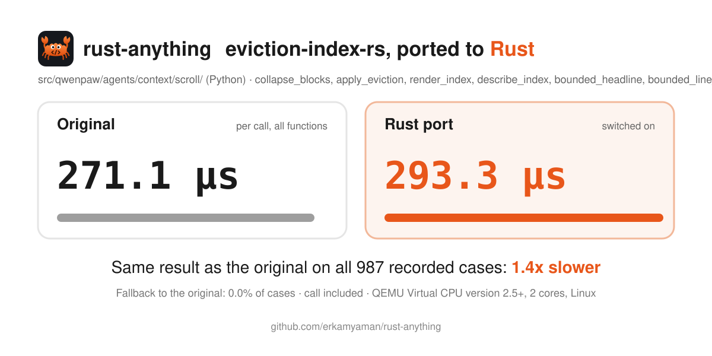

## `eviction-index-rs` in Rust

| | |
| --- | --- |
| Unit | `src/qwenpaw/agents/context/scroll/` (Python) |
| Recorded cases matched | 987 / 987 |
| Speedup, call included | 0.7x (geometric mean) |
| Fallback to the original | 0.0% (0 of 987 cases) |
| Switched on | on |

| Function | Cases | Original per call | Rust per call | Speedup |
| --- | ---: | ---: | ---: | ---: |
| `describe_index` | 106 | 87.3 µs | 98.0 µs | 0.9x |
| `render_index` | 525 | 84.3 µs | 78.7 µs | 1.1x |
| `collapse_blocks` | 98 | 35.2 µs | 32.2 µs | 1.1x |
| `apply_eviction` | 154 | 62.6 µs | 80.4 µs | 0.8x |
| `bounded_headline` | 72 | 391 ns | 823 ns | 0.5x |
| `bounded_line_text` | 32 | 1.3 µs | 3.2 µs | 0.4x |

Measured with `rust-anything report` on QEMU Virtual CPU version 2.5+, 2 cores, Linux: `diff` replays every recorded case, `bench` times them on both sides as callers call them. Reproduce: `rust-anything diff` and `rust-anything bench` in the crate folder.
