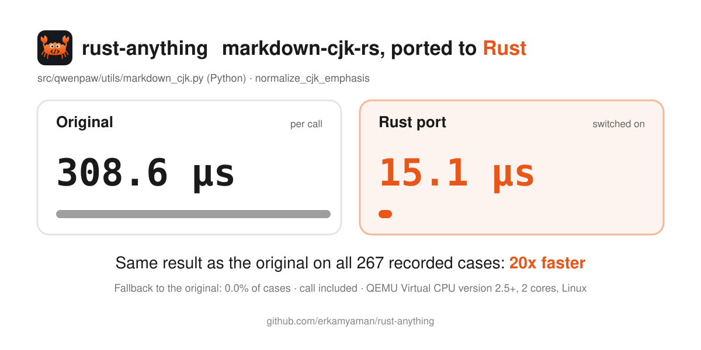

## `markdown-cjk-rs` in Rust

| | |
| --- | --- |
| Unit | `src/qwenpaw/utils/markdown_cjk.py` (Python) |
| Recorded cases matched | 267 / 267 |
| Speedup, call included | 20x (geometric mean) |
| Fallback to the original | 0.0% (0 of 267 cases) |
| Switched on | on |

| Function | Cases | Original per call | Rust per call | Speedup |
| --- | ---: | ---: | ---: | ---: |
| `normalize_cjk_emphasis` | 267 | 308.6 µs | 15.1 µs | 20x |

Measured with `rust-anything report` on QEMU Virtual CPU version 2.5+, 2 cores, Linux: `diff` replays every recorded case, `bench` times them on both sides as callers call them. Reproduce: `rust-anything diff` and `rust-anything bench` in the crate folder.
